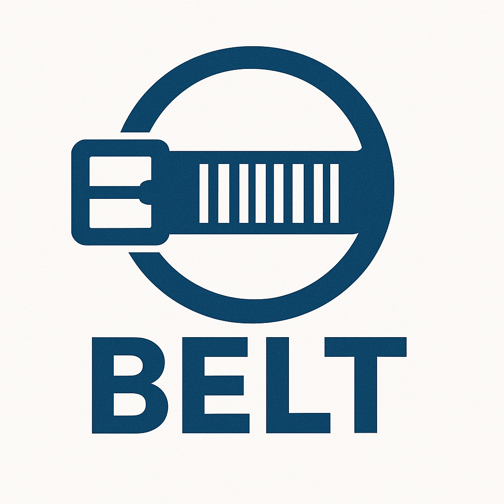

<div align="center">
  
</div>

# BELT - BalazsLab Error-correction Longread Tools

BELT is a toolkit designed for processing and analyzing long-read sequencing data. It provides functionality for extracting reads based on motifs and UMIs (Unique Molecular Identifiers), grouping reads by UMIs, and analyzing UMI distributions. BELT also allows for the integration of short-read sequencing data to error-correct UMIs from the long-read sequencing data.

## Features

- **extract**: Extract reads based on motifs and UMIs from BAM files
- **umi-map**: Map UMIs to a whitelist and generate paired UMI output
- **umi-group**: Group long-read UMIs based on corrected UMI data
- **whitelist**: Generate a whitelist of UMIs from sequencing data
- **consensus**: Generate consensus sequences from grouped BAM file
- **run-pipeline**: Run the entire pipeline using a configuration file

## Quick Start

### Prerequisites

- Python 3.8 or higher
- Git

### Installation

1. **Clone the repository:**
   ```bash
   git clone https://github.com/adamn102/belt
   cd belt
   ```

2. **Set up the development environment:**
   ```bash
   # Run the automated setup script
   ./install.sh
   ```

3. **Activate the virtual environment:**
   ```bash
   source .venv/bin/activate
   ```

4. **Verify installation:**
   ```bash
   ./belt.py --help
   ```

That's it! You're ready to use BELT.

### 🧪 Try the Demo Pipeline

Want to see BELT in action? Run the complete demo pipeline:

```bash
# Navigate to the demo directory
cd demo

# Run the complete demo (automatically sets up conda environment)
./run_demo.sh
```

The demo automatically creates a conda environment with all required tools and processes real test data through the entire BELT workflow. It serves as both a learning tool and a template for your own pipelines. See the [demo documentation](demo/README.md) for details.

## Usage

### Getting Help

```bash
# Show all available commands
./belt.py --help

# Show help for a specific command
./belt.py extract --help
./belt.py umi-map --help
./belt.py umi-group --help
./belt.py whitelist --help
./belt.py consensus --help
./belt.py run-pipeline --help
```

### Command Examples

#### Map Command
Map FASTQ reads to reference using minimap2 with filtering, sorting, indexing, and optional demultiplexing:

**Basic mapping (no demultiplexing):**
```bash
./belt.py map \
  --reference reference.fasta \
  --fastq input.fastq \
  --output-dir output_directory \
  --min-length 1000 \
  --min-quality 7 \
  --threads 4
```

**With CSV-based demultiplexing:**
```bash
./belt.py map \
  --reference reference.fasta \
  --fastq input.fastq \
  --output-dir output_directory \
  --sample-sheet barcodes.csv \
  --search-window 200 \
  --mismatch-threshold 2
```

**CSV Format Example (barcodes.csv):**
```csv
barcode_1,barcode_2,sample_name
ATCGATCGATCGATC,TTTTTTTTTTTTTT,sample1
GCATGCATGCATGC,CCCCCCCCCCCCCC,sample2
TTTTTTTTTTTTTT,AAAAAAAAAAAAAA,sample3
```

This command will:
1. Filter the FASTQ file based on read length and quality
2. Map reads to the reference using minimap2 (optimized for N-base mapping) and sort in one step
3. Index the final BAM file
4. Demultiplex reads based on provided barcodes (if CSV specified)

**Note**: The mapping is optimized for aligning barcode sequences (N bases) to N regions in the reference sequence using parameters like `--score-N=0` to not penalize N bases.

**Output files:**
- `{sample}_filtered.fastq`: Filtered FASTQ file
- `{sample}.bam`: Final BAM file
- `{sample}.bam.bai`: BAM index file
- `demultiplexed/`: Directory containing demultiplexed BAM files (if demultiplexing enabled)
  - `{sample_name}.bam`: BAM file for each sample (using names from CSV)
  - `unassigned.bam`: Reads that couldn't be assigned to any barcode

#### Extract Command
Extract reads based on motifs and UMIs:

```bash
./belt.py extract \
  --reference reference.fasta \
  --alignment input.bam \
  --output output.bam \
  --min_read_length 3900 \
  --motif NNNNNNNNNNNN
```

#### UMI Map Command
Map UMIs to a whitelist and generate paired UMI output:

```bash
./belt.py umi-map \
  --whitelist whitelist.csv \
  --reference reference.fasta \
  --alignment input.bam \
  --motif NNNNNNNNNNNN \
  --output_dir output_directory \
  --min_read_length 2000
```

#### UMI Group Command
Group long-read UMIs based on corrected UMI data:

```bash
./belt.py umi-group \
  --reference reference.fasta \
  --alignment input.bam \
  --corrected_umis corrected_umis.csv \
  --output_dir output_directory \
  --grouping 5pUMI \
  --threshold 10
```

#### Whitelist Command
Generate a whitelist of UMIs:

```bash
./belt.py whitelist \
  --reference reference.fasta \
  --alignment input.bam \
  --motif NNNNNNNNNNNN \
  --output_dir output_directory \
  --min_read_length 250
```

#### Consensus Command
Generate consensus sequences from grouped BAM file:

```bash
./belt.py consensus \
  --grouped-bam grouped.bam \
  --reference reference.fasta \
  --output-dir output_directory \
  --sample sample_name \
  --tag ZU \
  --threads 2 \
  --procs 1 \
  --umi-threads 1 \
  --model r1041_e82_400bps_sup_variant_v5.0.0
```

#### Run Pipeline Command
Run the entire pipeline using a configuration file:

```bash
./belt.py run-pipeline --config config.yaml
```

Example configuration file (`config.yaml`):
```yaml
reference: reference.fasta
alignment: input.bam
min_read_length: 3900
motif: NNNNNNNNNNNN
output: output.bam
whitelist: whitelist.csv
output_dir: output_directory
corrected_umis: corrected_umis.csv
grouping: 5pUMI
threshold: 10
```

## Development

### Manual Setup (Alternative)

If you prefer to set up manually instead of using the automated script:

```bash
# Create virtual environment
python3 -m venv .venv
source .venv/bin/activate  # On Unix/macOS
# or
.venv\Scripts\activate     # On Windows

# Install dependencies
pip install --upgrade pip
pip install -r requirements.txt

# Install BELT in development mode
pip install -e .
```

### Testing

Run tests to ensure everything works:

```bash
# Run all tests
python -m pytest tests/

# Run with coverage
python -m pytest tests/ --cov=scripts
```

## Troubleshooting

### Common Issues

**Command not found:**
- Make sure the virtual environment is activated: `source .venv/bin/activate`
- Try running `./belt.py` instead of `belt`

**Import errors:**
- Reinstall dependencies: `pip install -r requirements.txt`
- Reinstall the package: `pip install -e .`

**Permission errors:**
```bash
chmod +x belt.py
chmod +x install.sh
```

### Getting Help

- Check the [Development Guide](DEVELOPMENT.md) for detailed setup instructions
- Look at the test files in the `tests/` directory for examples
- Create an issue in the repository if you encounter problems

## Project Structure

```
belt/
├── belt.py              # Main entry point
├── install.sh           # Automated setup script
├── requirements.txt     # Python dependencies
├── setup.py            # Package configuration
├── scripts/            # Main BELT scripts
│   ├── belt.py         # CLI implementation
│   ├── extract.py      # Extract functionality
│   ├── umi_map.py      # UMI mapping
│   ├── umi_group.py    # UMI grouping
│   ├── whitelist.py    # Whitelist generation
│   ├── consensus.py    # Consensus calling
│   └── utils.py        # Utility functions
├── test-data/          # Test data files
├── tests/              # Test files
└── .venv/              # Virtual environment (created by setup)
```

## Contributing

1. Fork the repository
2. Create a feature branch
3. Make your changes
4. Test thoroughly
5. Submit a pull request

## Contributors

- **[nartsav](https://github.com/nartsav)** - Primary Co-developer

## License

This project is licensed under the MIT License - see the [LICENSE](LICENSE) file for details.

## Citation

If you use BELT in your research, please cite:

```
BELT: BalazsLab Error-correction Longread Tools
https://github.com/adamn102/belt
```

## Support

For questions and support:
- Check this README and the [Development Guide](DEVELOPMENT.md)
- Look at the test files for usage examples
- Create an issue in the repository
